

<picture><source media="(prefers-color-scheme: dark)" srcset="assets/hero-dark.svg"></picture>

<picture><source media="(prefers-color-scheme: dark)" srcset="assets/social-l-dark.svg"></picture><a href="https://naplon.xyz"><picture><source media="(prefers-color-scheme: dark)" srcset="assets/social-1-dark.svg"></picture></a><a href="https://discord.com/users/828866578614452236"><picture><source media="(prefers-color-scheme: dark)" srcset="assets/social-2-dark.svg"></picture></a><a href="naplon@protonmail.com"><picture><source media="(prefers-color-scheme: dark)" srcset="assets/social-3-dark.svg"></picture></a><picture><source media="(prefers-color-scheme: dark)" srcset="assets/social-r-dark.svg"></picture>

<picture><source media="(prefers-color-scheme: dark)" srcset="assets/about-dark.svg"></picture>

<picture><source media="(prefers-color-scheme: dark)" srcset="assets/stack-dark.svg"></picture>

<a href="https://github.com/naplon74/CleanMe"><picture><source media="(prefers-color-scheme: dark)" srcset="assets/project-cleanme-dark.svg"></picture></a>&nbsp;<a href="https://github.com/naplon74/gitRE"><picture><source media="(prefers-color-scheme: dark)" srcset="assets/project-gitre-dark.svg"></picture></a>

<a href="https://github.com/naplon74/brave-linux-debloat"><picture><source media="(prefers-color-scheme: dark)" srcset="assets/project-brave-linux-debloat-dark.svg"></picture></a>&nbsp;<a href="https://github.com/naplon74/magisk-pluskey"><picture><source media="(prefers-color-scheme: dark)" srcset="assets/project-magisk-pluskey-dark.svg"></picture></a>

<picture><source media="(prefers-color-scheme: dark)" srcset="assets/stats-dark.svg"></picture>

<picture><source media="(prefers-color-scheme: dark)" srcset="assets/streak-dark.svg"></picture>

<picture><source media="(prefers-color-scheme: dark)" srcset="assets/wave-dark.svg"></picture>

<a href="https://naplon.xyz"><picture><source media="(prefers-color-scheme: dark)" srcset="assets/button-1-dark.svg"></picture></a>&nbsp;&nbsp;<a href="https://github.com/naplon74?tab=repositories"><picture><source media="(prefers-color-scheme: dark)" srcset="assets/button-2-dark.svg"></picture></a>

<a href="https://metawka.github.io/expressive-profile/?from=naplon74"><picture><source media="(prefers-color-scheme: dark)" srcset="assets/credit-dark.svg"></picture></a>

